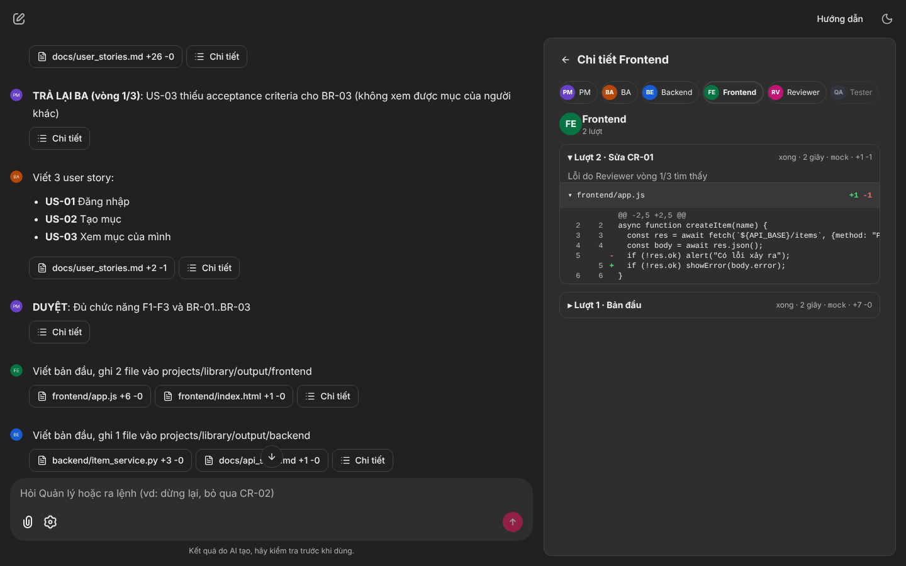
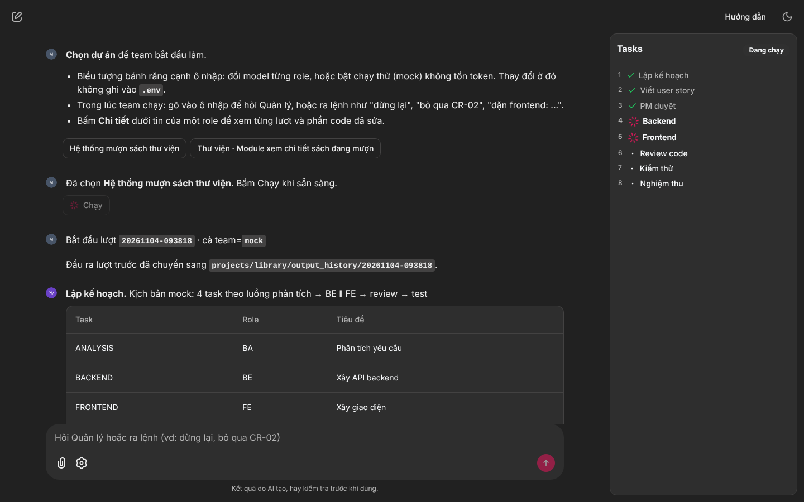
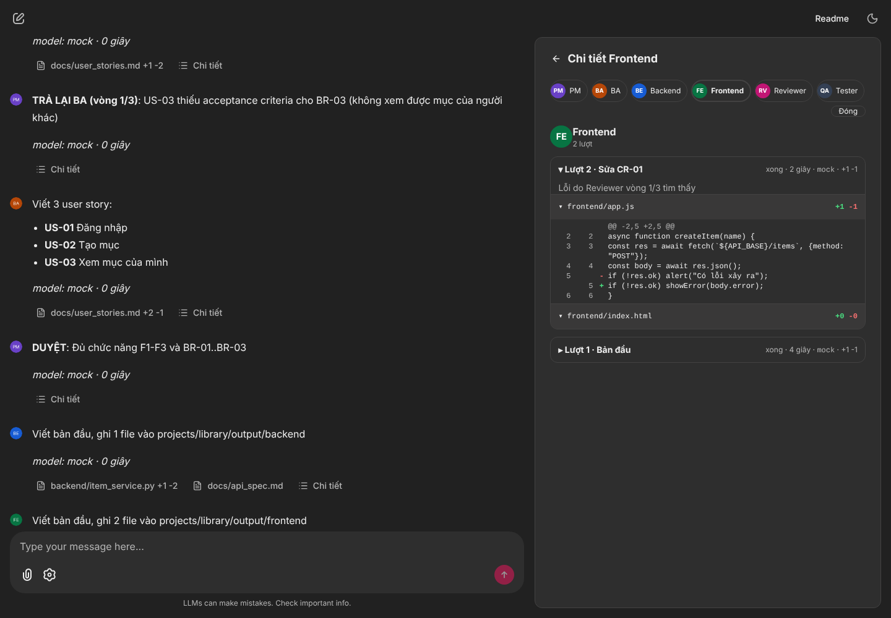
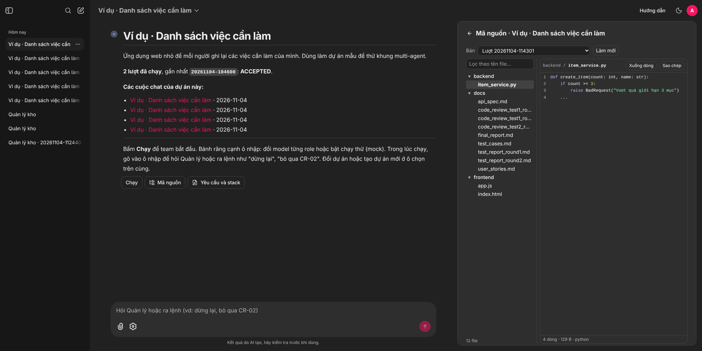
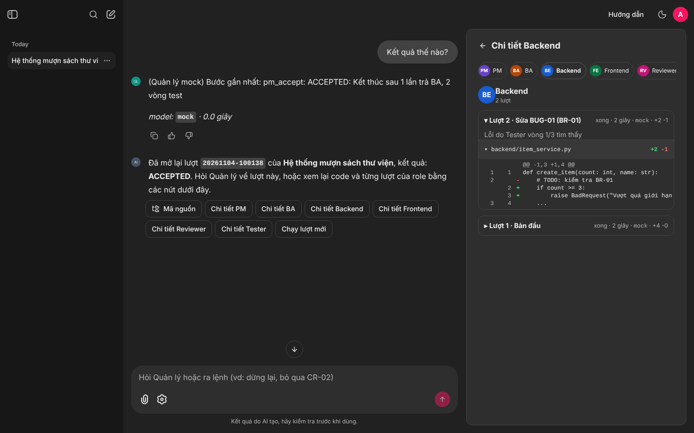
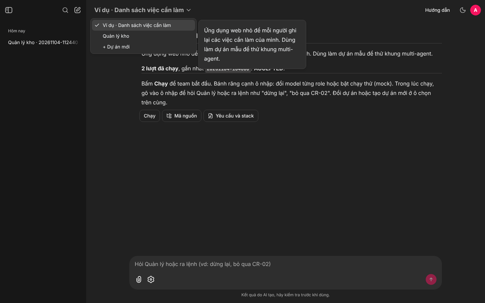
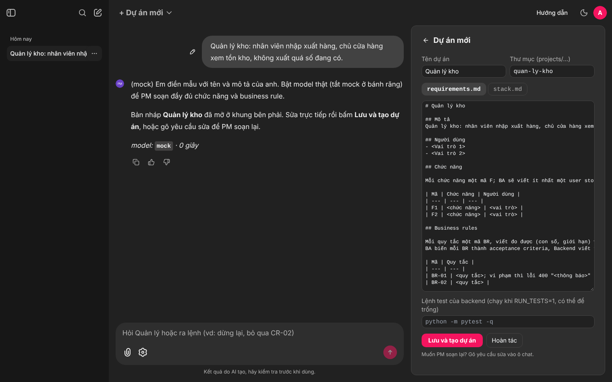

# Multi-agent team: AI agent mô phỏng team phần mềm

Một team AI (PM, BA, Backend, Frontend, Reviewer, Tester) cùng xây phần mềm từ file requirements của bạn, giống ý tưởng của MetaGPT nhưng luồng làm việc là một graph LangGraph rõ ràng, kèm giao diện Chainlit để theo dõi, chat với Quản lý, xem code và xem lại lịch sử. Clone về, tạo dự án của bạn trong `projects/`, chọn model cho từng role (Claude, OpenAI, OpenRouter, Ollama, hay provider riêng của bạn) rồi chạy.



## Bắt đầu nhanh

```powershell
git clone https://github.com/huuvietnguyen72/multi-agent-team.git
cd multi-agent-team
python -m venv .venv
.venv\Scripts\Activate.ps1          # macOS/Linux: source .venv/bin/activate
pip install -r requirements.txt     # cần Python 3.11 đến 3.13
copy .env.example .env              # macOS/Linux: cp .env.example .env
chainlit run ui/app.py              # mở http://localhost:8000, đăng nhập admin / admin
```

Ô chọn ở góc trên là danh sách dự án (giống Project của Claude). Chọn **Ví dụ · Danh sách việc cần làm**, bật **Chạy thử (mock)** ở biểu tượng bánh răng rồi bấm **Chạy**: cả luồng chạy bằng kịch bản giả, không tốn token. Sau đó làm theo mục [Tạo dự án mới](#tạo-dự-án-mới) và [Model và provider](#model-và-provider) để chạy cho dự án của bạn với model thật.

## Cách hoạt động

Khung dùng chung cho nhiều dự án: 6 agent (PM, BA, Backend, Frontend, Reviewer, Tester) do LangGraph điều phối, cùng xây một phần mềm từ requirements của một dự án trong `projects/<tên>/`. Mỗi agent đọc `skills/<role>/SKILL.md` (quy trình chung, không gắn với dự án nào) làm system prompt; stack và quy ước kỹ thuật riêng của dự án (`projects/<tên>/stack.md`) được chèn vào đầu prompt. Agent trả JSON theo schema Pydantic (`schemas.py`). Mọi bước được ghi vào `runs/<run_id>.jsonl` và phản ánh lên Plane.

Có sẵn `projects/_template/` (mẫu để chép) và `projects/example/` (một ứng dụng danh sách việc cần làm nhỏ, FastAPI + HTML/JS, để thử). Các dự án khác bạn tạo trong `projects/` không được commit (xem `.gitignore`), nên có thể pull bản mới của khung mà không lẫn dự án riêng.

## Luồng

```
pm_plan → ba → pm_review ─(chưa đạt, <3 vòng)→ ba
                         ─(3 vòng vẫn chưa đạt)→ pm_accept
                         ─(đạt)→ backend ‖ frontend → reviewer ─(finding chặn, <3 vòng)→ dev có finding → reviewer
                                                               ─(duyệt hoặc hết vòng)→ tester
tester ─(có bug, <3 vòng)→ dev có bug → reviewer → tester
       ─(PASS hoặc hết 3 vòng)→ pm_accept → END
```
Mọi lần Dev sửa code (kể cả sửa bug của Tester) đều qua Reviewer trước khi test lại.
Sơ đồ Mermaid sinh từ code: `docs/graph.mmd` (dán vào https://mermaid.live để xuất ảnh).

## Chạy bằng dòng lệnh

```powershell
python main.py --list                                # liệt kê dự án trong projects/
python main.py --project example --model mock         # kịch bản giả cố định, không tốn token, để thử luồng
python main.py --project example                      # model theo MODEL / MODEL_<ROLE> trong .env, hỏi xác nhận trước
python main.py --project example --model ollama:qwen3:8b  # một model cho cả team lần này, bỏ qua MODEL_<ROLE>
python main.py --project example --yes                # không hỏi xác nhận (bắt buộc khi chạy nền / CI)
python main.py --project example --module gio-hang   # làm module projects/example/modules/gio-hang.md tiếp trên code đang có
python main.py --draw                                # chỉ in sơ đồ Mermaid
python -m pytest -q tests                            # test khung (không gọi model, không ghi vào projects/)
```

Đặt `PROJECT=<tên>` trong `.env` để khỏi gõ `--project` mỗi lần.

Đầu ra nằm trong `projects/<tên>/output/` (không commit): `docs/` (user stories, API spec, code review, test case, test report, nghiệm thu), `backend/`, `frontend/`. Mỗi dự án một thư mục riêng nên chạy dự án này không ghi đè dự án khác.

## Giao diện

Ngoài terminal, có thể xem team làm việc trên trình duyệt (Chainlit): mỗi role là một người trong khung chat, bảng tiến độ ghi bước nào đang chạy, bấm vào tên file để xem nội dung ở khung bên phải.

```powershell
pip install -r requirements.txt     # đã có chainlit; cần Python 3.11 đến 3.13, nên cài trong .venv
chainlit run ui/app.py              # chạy từ thư mục gốc repo, mở http://localhost:8000
```

- **Dự án** (ô chọn ở góc trên): mỗi thư mục trong `projects/` là một mục. Chọn một dự án thì trang chào hiện mô tả, số lượt đã chạy và kết quả gần nhất, các cuộc chat trước của dự án đó (bấm để mở lại), và các nút **Chạy cả dự án**, **+ Module mới**, **Mã nguồn**, **Yêu cầu và stack** (sửa `requirements.md`, `stack.md`, lệnh test ngay trên giao diện). Mục **+ Dự án mới**: gõ ý tưởng vài câu, PM soạn `requirements.md` và `stack.md` theo mẫu (skill `skills/setup/SKILL.md`, dùng model của PM; khi bật mock thì chỉ điền mẫu), sửa ở khung bên phải hoặc gõ yêu cầu để PM soạn lại, rồi bấm **Lưu và tạo dự án**: thư mục `projects/<tên>/` được tạo và chạy được ngay trong cuộc chat đó; tải lại trang thì dự án có trong ô chọn.
- **Module** (mỗi module một cuộc chat): trên trang dự án bấm **+ Module mới**, mô tả phần cần làm tiếp, PM soạn `projects/<tên>/modules/<module>.md` (skill `skills/module/SKILL.md`: mục tiêu, chức năng, BR dùng lại mã của requirements chung, phần liên quan tới code đã có, ngoài phạm vi), sửa rồi bấm **Lưu module**. Cuộc chat đó thành cuộc chat của module, bấm **Chạy module**. Lượt chạy module đưa yêu cầu module kèm requirements chung, cho Backend và Frontend đọc code đang có trong `output/` và chỉ sửa hoặc thêm phần cần thiết; `output/` được giữ nguyên (bản sao trước lượt nằm ở `output_history/`). Trang dự án liệt kê các module, kết quả lượt gần nhất của từng module và đường dẫn tới cuộc chat của nó. **Chạy cả dự án** thì vẫn làm lại từ đầu theo `requirements.md`.
- Bấm biểu tượng bánh răng để chọn file yêu cầu, model cho từng role và model ở vòng sửa cuối. Giá trị ban đầu lấy từ `.env`; `(không đổi)` ở model vòng cuối nghĩa là không nâng model.
- Bật **Chạy thử (mock)** để thử luồng không tốn token; **Độ trễ mỗi bước** làm chậm mỗi bước để kịp nhìn Backend và Frontend chạy song song.
- Bấm nút **Chạy** (hoặc nút tên dự án) để bắt đầu. Nếu có role dùng model thật, giao diện hiện bảng role → model để xác nhận như `main.py`. Mỗi lúc chỉ một lần chạy; bấm nút dừng thì graph dừng sau bước đang chạy.
- Nút **Chi tiết** ở mỗi tin nhắn mở bảng của role đó: từng lượt làm (bản đầu, sửa CR-xx, sửa BUG-xx), lượt đang chạy đến bước nào (nhận việc, đọc file, gọi model, nhận trả lời, ghi tệp), và phần sửa từng file dạng diff có dòng xóa (đỏ) và dòng thêm (xanh). Trong một lần gọi model thì không chia nhỏ hơn được, nên bước "gọi model" chỉ hiện số ký tự đã nhận khi provider có streaming.
- **Quản lý** (tin nhắn tên `Manager`): gõ vào khung chat bất cứ lúc nào, kể cả khi team đang chạy. Quản lý đọc trạng thái lượt chạy (role đang làm, vòng, finding, bug, các bước gần nhất) và trả lời. Nói rõ yêu cầu thì Quản lý đề xuất một lệnh, chỉ có hiệu lực khi bấm **Đồng ý**:

  | Ví dụ | Lệnh |
  | --- | --- |
  | "Dừng lại" | tạm dừng sau bước đang chạy, giữ trạng thái |
  | "Chạy tiếp" | chạy tiếp từ chỗ dừng, không làm lại bước cũ |
  | "Bỏ qua CR-04, báo nhầm" | finding (hoặc bug BUG-xx) không còn tính là phải sửa, Reviewer không nêu lại |
  | "Dặn frontend: hiện lỗi từ trường error" | thêm lời dặn vào prompt lượt làm kế tiếp của role đó, một lần |

- **Mã nguồn** (nút dưới tin chào của dự án, tin bắt đầu và tin kết quả): khung bên phải có cây thư mục đầu ra của dự án, ô lọc theo tên file, bấm file để xem code có tô màu cú pháp. Trong lúc team chạy, file mới ghi hiện lên ngay. Ô **Bản đầu ra** chọn lượt mới nhất (`output/`) hoặc một lượt cũ trong `output_history/` (giữ 5 lượt gần nhất; trước mỗi lượt, đầu ra cũ được chuyển vào đây).
- **Lịch sử chat**: giao diện yêu cầu đăng nhập, tài khoản là `UI_USERNAME` / `UI_PASSWORD` trong `.env` (chưa đặt thì `admin` / `admin`). Mọi tin nhắn lưu vào `.chainlit/history.db` (SQLite, không commit), các cuộc chat cũ nằm ở thanh bên trái, tên là dự án và mã lượt. Mở lại một cuộc chat cũ thì có nút **Mã nguồn** và **Chi tiết** của từng role cho lượt đó, và hỏi Quản lý về lượt đó được (state cuối của lượt lưu ở `runs/<mã lượt>.ui.json`). Lệnh như dừng hay bỏ qua chỉ áp được cho lượt đang chạy.

  Lệnh được áp giữa hai bước của graph (LangGraph `update_state` rồi chạy tiếp từ checkpoint), nên không cắt ngang một lần gọi model và không thêm vòng sửa nào. Mọi lệnh đã áp được ghi trong `final_report.md`, mục "Can thiệp của người dùng". Model của Quản lý: ô chọn trong cài đặt, hoặc `MODEL_MANAGER` trong `.env`, mặc định giống PM; khi bật mock thì dùng Quản lý mock hiểu lệnh theo từ khóa.

| Đang chạy | Chi tiết một role | Kết thúc |
| --- | --- | --- |
|  |  |  |

| Mã nguồn | Mở lại cuộc chat cũ |
| --- | --- |
|  |  |

| Danh sách dự án | Tạo dự án mới |
| --- | --- |
|  |  |

## Tạo dự án mới

Cách nhanh nhất là mục **+ Dự án mới** trên giao diện (xem mục Giao diện). Làm tay:

1. Chép `projects/_template/` thành `projects/<tên-dự-án>/`.
2. Sửa `requirements.md`: vai trò người dùng, chức năng `F1..Fn`, business rules `BR-xx` (đo được, kèm đúng thông báo lỗi), ví dụ kiểm thử.
3. Sửa `stack.md`: ngôn ngữ và framework backend/frontend, CSDL, cấu trúc thư mục, định dạng lỗi, cách xác thực, địa chỉ chạy. Đây là chỗ duy nhất ghi chi tiết kỹ thuật riêng của dự án; skills chỉ giữ nguyên tắc chung.
4. Sửa `project.toml`: tên hiển thị và `[tests].command` (ví dụ `mvn -q -B test`, `pytest -q`, `npm test --silent`). Đặt `RUN_TESTS=1` trong `.env` để Tester chạy lệnh này trên code agent sinh ra và dùng kết quả làm bằng chứng.
5. Chạy `python main.py --project <tên-dự-án> --model mock` để kiểm tra cấu hình, rồi chạy với model thật.

Team (6 role) và luồng là cố định; muốn đổi thì xem mục Skills bên dưới.

## Cấu trúc

| Thư mục / file | Vai trò |
| --- | --- |
| `graph.py` | Node, edge, conditional edge; giới hạn 3 vòng ở cả hai vòng lặp |
| `state.py` | `TeamState` dùng chung; `log` có reducer nối thêm để BE và FE chạy song song |
| `schemas.py` | Schema Pydantic cho đầu ra từng agent |
| `agents/` | Mỗi file một role; `common.py` gọi model của role và chèn stack của dự án vào prompt; `mock.py` là kịch bản giả cố định; `skills.py` đọc SKILL.md |
| `agents/providers/` | Chọn model theo role (`__init__.py`) và các adapter: `anthropic_api.py`, `openai_compat.py`, `claude_code.py` |
| `providers.toml` | Danh sách provider dùng chung (endpoint, tên biến chứa key, tùy chọn); `providers.local.toml` (không commit) thêm hoặc ghi đè cho riêng máy bạn |
| `skills/` | `skills/<role>/SKILL.md` cho 6 role, theo chuẩn Agent Skills (frontmatter `name`/`description`; Overview, When to Use, Process, Rules, Output Template, Red Flags, Verification). Chỉ chứa quy trình chung |
| `projects/` | Mỗi dự án một thư mục: `project.toml`, `requirements.md`, `stack.md`, `output/`. `_template/` là mẫu |
| `tools/` | `project.py` đọc dự án, `file_tools.py` ghi file vào output của dự án, `test_runner.py` chạy lệnh test của dự án, `plane_client.py`, `runlog.py` |

## Plane

Tạo project trên Plane với 5 state (Backlog, Todo, In Progress, In Review, Done) và 5 label (PM, BA, BE, FE, QA), rồi điền `PLANE_API_KEY`, `PLANE_WORKSPACE_SLUG`, `PLANE_PROJECT_ID` vào `.env`. Thiếu cấu hình thì client chạy dry-run (in `[plane:dry-run] ...`), lỗi Plane không làm dừng graph.

## Model và provider

Mỗi role gọi một model, chọn bằng cú pháp `<provider>:<model>` trong `.env`:

```
MODEL=claude-code:sonnet                  # mặc định cho mọi role
MODEL_BACKEND=opencode-go:glm-5.3         # riêng một role: pm, ba, backend, frontend, reviewer, tester
MODEL_TESTER=ollama:qwen3:8b              # role khác nhau có thể dùng nhà cung cấp khác nhau
EFFORT_BACKEND=high                       # tùy chọn: mức suy luận, giá trị hợp lệ tùy model
MAX_TOKENS_BACKEND=131072                 # tùy chọn: trần token đầu ra, tính cả token suy luận
```

`--model <provider>:<model>` dùng một model cho cả team trong lần chạy đó, bỏ qua `MODEL` và `MODEL_<ROLE>`. `--model mock` (hoặc `MODEL=mock`) cho cả team chạy kịch bản giả, không tốn token.

Trước khi chạy, `main.py` kiểm tra cấu hình và dừng nếu sai (provider chưa khai báo, thiếu model, thiếu key). Nếu có role dùng model thật, nó in bảng role → model và hỏi xác nhận; khi không có terminal (chạy nền, CI) thì phải thêm `--yes`, nếu không sẽ dừng.

**Provider** là một endpoint đặt tên trong `providers.toml`: adapter (`type`), địa chỉ, **tên** biến môi trường chứa key (key thật để trong `.env`, không bao giờ ghi vào toml), và tùy chọn. Có sẵn:

| Provider | Adapter | Ghi chú |
| --- | --- | --- |
| `claude-code` | `claude-code` | Claude Code CLI `claude -p`, dùng gói Claude Pro/Max đang đăng nhập; không cần API key. Bỏ qua `ANTHROPIC_API_KEY` để không chuyển sang tính tiền API |
| `claude-api` | `anthropic` | Claude API, `ANTHROPIC_API_KEY`; bật fallback phía server khi bị bộ lọc an toàn từ chối |
| `opencode-go` | `openai-compatible` | Gói OpenCode Go (GLM, Kimi, DeepSeek, ...), `OPENCODE_GO_API_KEY`; gửi header phiên `x-opencode-session` mà Go yêu cầu. DeepSeek mặc định chỉ phục vụ Châu Âu và Mỹ (bật **Global** trong Settings › Privacy › Regions nếu cần) |
| `openai`, `openrouter`, `deepseek`, `gemini` | `openai-compatible` | Cấu hình mẫu theo tài liệu nhà cung cấp, **chưa chạy thử** với dự án này |
| `ollama`, `lmstudio` | `openai-compatible` | Model chạy local, không cần key; **chưa chạy thử** |
| `mock` | `mock` | Kịch bản giả, luôn có |

Đã chạy thật: `claude-code` và `opencode-go`. Nếu bạn chạy được với provider khác, hãy mở PR sửa bảng này.

### Thêm provider của bạn

Nếu nhà cung cấp theo chuẩn OpenAI Chat Completions hoặc Anthropic Messages, chỉ cần thêm một mục vào `providers.local.toml` (hoặc `providers.toml` nếu muốn chia sẻ), ví dụ:

```toml
[providers.my-vllm]
type = "openai-compatible"
base_url = "http://gpu-box:8000/v1"
api_key_env = "MY_VLLM_KEY"          # bỏ dòng này nếu server không cần key
response_format = "json_object"      # json_schema (mặc định) | json_object | none, tùy server hỗ trợ
```

rồi đặt `MODEL_BACKEND=my-vllm:<tên model>`. Tùy chọn của từng adapter (header, tên tham số effort/max_tokens, timeout, ...) ghi ở đầu file adapter trong `agents/providers/`. Với giao thức khác hẳn: viết `agents/providers/<adapter>.py` có hàm `call(target, role, prompt, schema)` và đăng ký trong `agents/providers/__init__.py`.

Mọi adapter: skill của role làm system prompt, đầu ra ép theo JSON Schema từ `schemas.py` (adapter `openai-compatible` còn ghi schema vào system prompt cho server ép lỏng), sai schema thì thử lại 1 lần rồi dừng; đầu ra bị cắt do trần token thì báo lỗi kèm số ký tự trả lời và suy luận để biết nên tăng `MAX_TOKENS_<ROLE>` hay giảm `EFFORT_<ROLE>`. Lượt dùng tính theo nhà cung cấp: gói Claude và OpenCode Go có hạn mức theo khung giờ; chạm giới hạn thì bước đang chạy báo lỗi và graph dừng.

## Tự nâng model ở vòng sửa cuối

BA, Backend và Frontend có tối đa 3 vòng sửa. Có thể cho riêng vòng cuối dùng model mạnh hơn, để những lỗi model thường sửa mãi không được có thêm một cơ hội:

```
ESCALATE=claude-code:opus                    # mọi role được phép
ESCALATE_BACKEND=claude-api:claude-opus-5-5  # riêng một role, thắng ESCALATE
```

Chỉ áp dụng cho `ba`, `backend`, `frontend` (đặt `ESCALATE_REVIEWER` sẽ báo lỗi), và bỏ qua khi model thường là `mock`. Khi đổi, terminal in `↑ backend: đổi từ X sang Y vì đây là vòng sửa cuối`, log và giao diện ghi model đã dùng cho từng bước.

## Skills

Mỗi role có một `skills/<role>/SKILL.md`. Nội dung quy trình được rút gọn và chỉnh từ [addyosmani/agent-skills](https://github.com/addyosmani/agent-skills) (MIT, xem `THIRD_PARTY_NOTICES.md`) và viết chung cho mọi dự án: không nhắc đề, stack hay framework cụ thể. `tests/test_project.py` kiểm tra điều này. Khi stack của dự án quy định khác một quy tắc chung trong skill, agent làm theo stack. Adapter `anthropic` và `openai-compatible` bỏ frontmatter rồi dùng phần còn lại làm system prompt (`anthropic` có prompt caching); adapter `claude-code` nạp nguyên file.

`--model mock` dùng một kịch bản giả trung tính (3 user story về "mục" của người dùng), không đọc requirements hay stack; nó chỉ để kiểm tra luồng và định tuyến.

Thêm một role mới: tạo `skills/<role>/SKILL.md` cùng định dạng, thêm schema đầu ra trong `schemas.py`, một file trong `agents/`, một hàm giả trong `agents/mock.py`, rồi nối node vào `graph.py`.

## Giấy phép

MIT, xem `LICENSE`. Phần nội dung skills chỉnh từ addyosmani/agent-skills (MIT), xem `THIRD_PARTY_NOTICES.md`.
